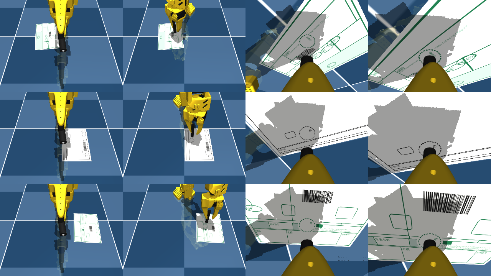
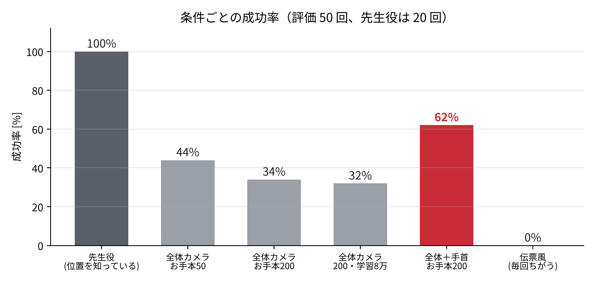

# SO-101 押印ロボット：AI（ACT）で丸枠の中にハンコを押す

Physical AI 応用1講座 最終課題

紙を置くと、ロボットアーム（SO-101）がカメラで紙の上の丸枠を見つけ、その中にハンコを押します。
押し方は計算で作った「お手本」から、模倣学習（LeRobot の ACT）で AI に覚えさせました。
AI は**枠の位置を教えられず、カメラ画像と関節の角度だけを見て**押す場所を決めます。



## タスクと成功条件

| 項目 | 値 |
|---|---|
| 印影の直径 | 10 mm（実物のハンコを硬貨と並べて測定） |
| 丸枠の内径 | 20 mm |
| 成功条件 | 印影全体が枠の内側 ＝ 印影の中心が枠の中心から **5 mm 以内** |
| 紙の置き場所 | アームの前方 16〜26 cm、左右 ±25° の範囲でランダム |

## 全体の流れ

```
① 先生役（逆運動学）が押す ──→ ② 映像と関節角度を記録 ──→ ③ ACT で学習 ──→ ④ AI だけで押させて評価
   stamp_sim.py                  record_demos.py              lerobot-train            eval_act_sim.py
                                 （Colab 版：01_record_demos_colab.ipynb）
```

1. **先生役のお手本**：シミュレーター（MuJoCo）上の SO-101 にハンコを持たせ、逆運動学で丸枠の真上へ動かし、
   真下にまっすぐ下ろして押す。
2. **記録**：1/30 秒ごとに「カメラ画像（640×480）」「6 つのモーターの角度」「次の目標角度」を LeRobot のデータセット形式で保存。
3. **学習**：LeRobot 0.6.1 の ACT（Action Chunking with Transformers）で模倣学習。
4. **評価**：学習に使っていない紙の位置で AI に押させ、成功率とずれを測る。

## ファイル

| ファイル | 内容 |
|---|---|
| `stamp_sim.py` | シミュレーションの共通部品（ハンコの取り付け、手首カメラ、逆運動学、紙・丸枠の描画、成功判定） |
| `paper_gen.py` | 伝票風の紙の画像を毎回ちがう見た目で作る（点線の押印欄、表、文字、まぎらわしい丸） |
| `record_demos.py` | お手本を記録して LeRobot のデータセットにする（途中から再開可能） |
| `eval_act_sim.py` | 学習した ACT をシミュレーションで動かし、成功率・散布図・動画を出力 |
| `make_video.py` | 評価の動画と結果のグラフをつないで、提出用の動画を作る |
| `check_arm.py` | 実機（SO-ARM101）の状態を読むだけで診断する（通信・電圧・温度・負荷・保存された設定） |
| `01_record_demos_colab.ipynb` | お手本記録の Colab 版（Google ドライブに1回ずつ保存、GPU なしでも動作） |

## 動かし方

環境：Windows 11 / RTX 5070 Laptop（VRAM 8GB）/ Python 3.12 / LeRobot 0.6.1

```bash
conda create -y -n lerobot python=3.12
conda activate lerobot
pip install "lerobot[dataset,training]==0.6.1" mujoco mediapy imageio-ffmpeg --extra-index-url https://download.pytorch.org/whl/cu128

# ① ② お手本を200回記録してデータセットにする（SO-101 のモデルは自動でダウンロード）
python record_demos.py --episodes 200

# ③ 学習
lerobot-train --dataset.repo_id=local/so101_stamp_sim200 --dataset.root=C:/so101/so101_stamp_sim200 \
  --dataset.video_backend=pyav --policy.type=act --policy.device=cuda --policy.push_to_hub=false \
  --output_dir=C:/so101/outputs/act_stamp200 --batch_size=8 --steps=30000 --wandb.enable=false

# ④ 評価（50回）
python eval_act_sim.py --temporal-ensemble --trials 50 \
  --policy C:/so101/outputs/act_stamp200/checkpoints/030000/pretrained_model
```

手首カメラ付き・伝票風の紙で試すときは、記録に `--wrist`、紙の種類に `--paper form`（毎回ちがう伝票）または
`--paper fixed`（同じ伝票1種類）を付けます。評価は AI が使うカメラを自動で読み取り、紙の種類は `--paper` で指定します。

※ Windows では学習中のシンボリックリンク作成で止まるため、「設定 → システム → 開発者向け → 開発者モード」をオンにしてください。

## 結果

| AI | お手本 | 動かし方 | 試行 | 成功率 | ずれ 平均 | ずれ 最大 |
|---|---|---|---|---|---|---|
| 先生役（逆運動学・正解の位置を知っている） | – | – | 20 | 100% | 1.44 mm ※ | 2.83 mm |
| ACT | 50 回 | 100 コマごとに予定を立て直す | 20 | 25% | 7.02 mm | 13.96 mm |
| ACT | 50 回 | 毎コマ立て直して平均（temporal ensemble） | 20 | 40〜50% | 5.6 mm | 16.2 mm |
| ACT | 50 回 | temporal ensemble | 50 | 44% | 5.68 mm | 18.66 mm |
| ACT | 200 回（学習 3 万回） | temporal ensemble | 50 | 34%（紙に触れない 10 回） | 5.40 mm | 8.77 mm |
| ACT | 200 回（学習 8 万回） | temporal ensemble | 50 | 32% | 9.46 mm | 19.83 mm |
| ACT ＋**手首カメラ** | 200 回（学習 3 万回） | temporal ensemble | 50 | **62%** | **4.33 mm** | **7.71 mm** |
| ACT ＋手首カメラ・**伝票風の紙**（毎回ちがう模様・配置） | 200 回（学習 3 万回） | temporal ensemble | 50 | 0%（紙に触れない 11 回） | 24.60 mm | 52.63 mm |

※ 先生役には、カメラで枠を見つけるときの誤差（標準偏差 1 mm）をわざと加えて評価。
試行 50 回の成功率は ±7% 程度ぶれるため、比較には平均のずれも併せて見ています。



## 工夫した点

- **測れる成功条件**：実物の印影を硬貨と比べて約 10 mm と測り、枠 20 mm から「中心のずれ 5 mm 以内」と決めた。
- **原因を数字で切り分け**：最初はハンコが紙に届かなかった。20 回とも 5.3〜5.8 mm 浮いていたことから、位置によらない
  「指先が先に当たる」問題と特定し、ハンコを指先から 25 mm 突き出して持たせて解決した。
- **ずれの分解**：押した位置のずれを「経路」「たわみ」「紙の上での滑り」に分けて測り、
  1 mm ごとに逆運動学を解く「真下へ一直線に下ろす経路」で経路のずれを 0.55 mm → 0 mm にした。
- **押し付けの深さ**：深さを 0.5〜4 mm で変えて、ずれと押す力の関係をグラフにした。
  1.5 mm 以上は力が増えずにずれだけ増えることがわかり、1 mm を選んだ（クセ 0.99 → 0.44 mm）。
- **AI の動かし方**：ACT が最初の画像だけで 3.3 秒分の動きを決めていたことが外れる原因と考え、
  毎コマ予定を立て直す temporal ensemble にして成功率を 25% → 40〜50% にした（学習し直しなし）。
- **失敗の傾向の分析**：外れ方が紙の位置で決まっている（左側はさらに左へ、手前は奥へ約 5 mm）ことを見つけ、
  お手本を 50 → 200 回に増やして苦手な場所を補った。
- **原因は「目」だと考えて手首カメラを追加**：お手本を 4 倍、学習を 2.7 倍にしても成功率は 30〜45% から上がらなかった。
  量ではなく、遠くのカメラでは直径 20mm の枠が約 20 画素にしか写らないことが原因と考え、実機と同じ位置に手首カメラを付けた。
  お手本・学習の量は同じまま、成功率 34% → 62%、ずれの最大 8.77 → 7.71 mm、平均 5.40 → 4.33 mm に改善した。
- **止まっても続きから**：Colab の切断で 38 回分のお手本を失った反省から、1 回ずつ保存して再開できる記録方法にした。

## 実機（SO-ARM101）について

実機では、モーターに何も書き込まない診断プログラム（`check_arm.py`）で状態を確認しました。
通信・電圧は安定していた一方、フォロワーの可動範囲がリーダーより大きく狭く保存されていること
（肩の上下 71° など）と、はさみの範囲が実際の開閉と合っていないことがわかり、
はさみの過負荷・閉じすぎの原因と考えています。キャリブレーションを見直したうえで、
シミュレーションと同じ手順（リーダーでお手本を記録 → ACT で学習 → AI で押す）を実機で進めます。

安全のため、モーターの検出や過負荷保護は無効化せず、AI の出力は動ける量を制限してから実機に送る方針です。

## 使用したもの

- ロボットのモデル：[SO-ARM100 / SO-101](https://github.com/TheRobotStudio/SO-ARM100)（TheRobotStudio）
- 学習：[LeRobot](https://github.com/huggingface/lerobot) 0.6.1（Hugging Face）の ACT
- シミュレーター：[MuJoCo](https://mujoco.org/)

## AI ツールの利用

コードの作成、実験の計画、結果の分析の一部に AI アシスタント（Claude）を利用しました。
実験の実行、結果の確認、方針の判断は自分で行いました。

## ライセンス

MIT License（`LICENSE` を参照）
